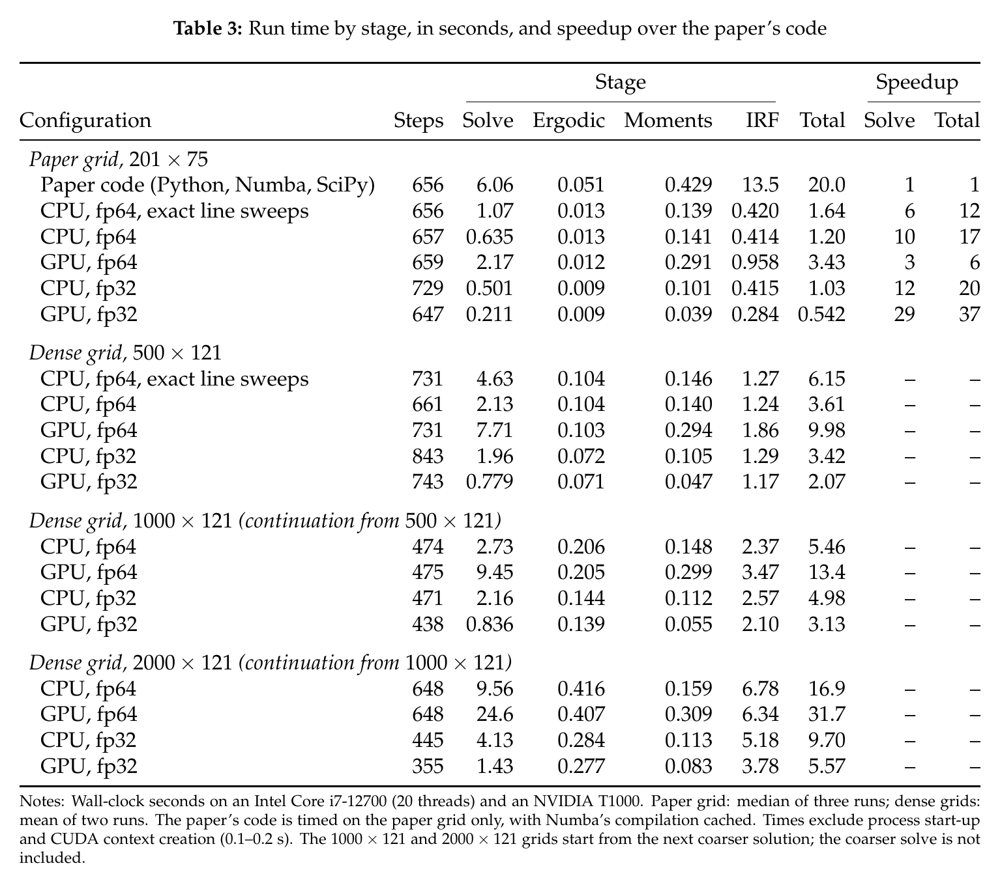

# Partial-Default-Replication-CUDA

> **Note:** This is an experimental, automated port written by Grok Bot. It aims at performance and at experimenting with GPU solutions in single and double precision.

The official replication package, which this port is based on, is at [gabrielgggg/Partial-Default-Replication](https://github.com/gabrielgggg/Partial-Default-Replication).

A performance-oriented C++/CUDA rewrite of the main computation of the quantitative diffusion model of partial
default (main calibration): the equilibrium (HJB and bond-price equations by implicit upwind pseudo-time stepping),
the ergodic distribution, the moments of Table 2 (ergodic moments and 16 simulated paths of 25,000 years), and the
impulse responses of Figures 8 and F.1. One binary runs a multicore CPU back end (OpenMP) or a GPU back end (CUDA),
in double (`fp64`) or single (`fp32`) precision.

The report, `report/report.pdf` (LaTeX source `report/report.tex`), describes the design, the verification against
the paper's code, the run times, single against double precision, and the dense-grid results, and reproduces the
paper's exhibits on the paper grid and on a 2000 x 121 grid.

## Headline numbers (Intel i7-12700, 20 threads; NVIDIA T1000)

| Grid | Paper code (total) | Fastest rewrite (total) | Speedup |
|---|---|---|---|
| 201 x 75 (paper) | 20.0 s | 0.54 s (GPU, fp32); 1.20 s (CPU, fp64) | 37x; 17x |
| 500 x 121 | not timed | 2.07 s (GPU, fp32); 3.61 s (CPU, fp64) | |
| 1000 x 121 | not timed | 3.13 s (GPU, fp32); 5.46 s (CPU, fp64) | |
| 2000 x 121 | not timed | 5.57 s (GPU, fp32); 16.9 s (CPU, fp64) | |

The full table by stage is Table 3 of the report:



## Build

Requires the NVIDIA HPC SDK (or any CUDA toolkit with `nvcc`) and a host compiler with OpenMP.

```
make                       # bin/km; edit SDK, CUDA, ARCH at the top of the Makefile (default sm_75)
```

## Inputs

`inputs/params.txt` (the calibrated parameters) and `inputs/init.bin` (the starting point, on the paper grid) are
written from the replication package by `tools/make_inputs.py`. The replication package itself is expected at `ref/`
(it is not part of this repository); it is needed for the paper-code baseline and for the figures, which use the
package's own plotting functions (`ref/code/make_figures.py`).

## Run

```
bin/km --backend gpu --fp 32 --params inputs/params.txt --init inputs/init.bin --out results/p_gpu32
bin/km --backend cpu --fp 64 --params inputs/params.txt --init inputs/init.bin --sweep_tol 1e-9 --out results/p_cpu64
```

Each run writes `V, q, S, c, d, g, frozen, which, B, z, irf, irf_t` as `.npy` and `meta.json` (settings,
residuals, stage times, moments, loss) to `--out`.

Main options (defaults in brackets):

| Option | Meaning |
|---|---|
| `--backend cpu\|gpu` [gpu] | back end |
| `--fp 64\|32` [64] | precision |
| `--nB`, `--nz` [201, 75] | grid; the starting point is interpolated bilinearly to other grids |
| `--tolV`, `--tolq` [1e-7, 1e-8] | fp64 tolerances on the residuals of the stationary equations (max norm) |
| `--dt0`, `--dt_max` [0.015, 0.5] | first and largest pseudo-time step (growth factor 1.02) |
| `--maxit` [5000] | step cap |
| `--sweep_tol` [1e-13] | relative tolerance of the line sweeps (the report's fast fp64 runs use 1e-9) |
| `--maxpass` [60] | sweep passes per linear solve |
| `--chunk_rows` [-1] | debt rows per chunk of the block line Gauss-Seidel; -1 automatic, 0 one chunk (exact sweeps) |
| `--tol32` [64], `--stall_window` [150] | fp32 stopping rule: residuals below tol32 x eps32 (relative for V), or no new low of either residual within stall_window steps after dt reaches dt_max |
| `--n_golden` [28] | golden-section iterations of the node problem |
| `--paths`, `--years`, `--seg_years`, `--burn_seg`, `--seed` [16, 25000, 125, 25, 1] | simulation |
| `--irf_iters` [3] | zebra relaxation iterations per Crank-Nicolson step of the impulse responses |
| `--irf_all_rows` [400] | GPU: from this many debt levels on, the impulse-response kernels loop over runs within a warp |
| `--nosim`, `--noirf`, `--quiet`, `--verbose` | skip stages; output level |

Further options (`--extrap`, `--relax`, `--accel_*`, `--sim_layout`) are experiment switches, off or at their
neutral value by default.

## Dense grids

500 x 121 runs with the paper's algorithm and criteria. 1000 x 121 and 2000 x 121 start from the next coarser
solution (`tools/to_init.py`), with `--dt_max` = min(0.5, 250 h_B) (0.25 and 0.125) and `--tolq 1e-6`:

```
python tools/to_init.py results/d500_cpu64 inputs/init_d500_cpu64.bin
bin/km --backend cpu --fp 64 --nB 1000 --nz 121 --dt_max 0.25 --tolq 1e-6 --sweep_tol 1e-9 \
       --params inputs/params.txt --init inputs/init_d500_cpu64.bin --out results/d1000_cpu64
```

## Reproduce the report

```
tools/bench.sh                                     # every configuration of the tables -> results/
python baseline/bench_ref.py baseline/run1         # the paper's code, paper grid (needs ref/)
python tools/tables.py                             # report/tables/*.tex
python tools/plots.py results/p_cpu64 report/figures _201
python tools/plots.py results/d2000_cpu64 report/figures _2000
python tools/plots_extra.py report/figures
cd report && pdflatex report && pdflatex report
```

## Layout

```
src/        km.cu (driver), model.h, shared.h, cpu_backend.h, gpu_backend.cuh, post.h
tools/      bench.sh, tables.py, plots.py, plots_extra.py, make_inputs.py, to_init.py, compare.py
baseline/   bench_ref.py and the paper code's outputs on the paper grid (run1)
inputs/     params.txt, init.bin
results/    meta.json of every run; full arrays of the paper-grid runs and of d2000_cpu64
report/     report.tex, report.pdf, tables/, figures/
```
